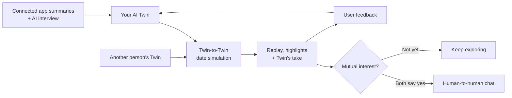

# TwinDate

### Let your Twin date first.

**What if you could see how a first date might go before going on it yourself?**

TwinDate gives you an AI Twin that learns how you communicate, goes on simulated first dates with other people's Twins, and brings back the conversations worth your time. Watch the chemistry unfold, decide who you'd like to meet, and take it from there.

**[Try the live demo](https://twin-date-compiled-17.vercel.app/)** · **[Watch on YouTube](https://www.youtube.com/watch?v=V3odBsdKDos)**

> Built by **Team Five Hours** for [c0mpiled-17: Seoul](https://luma.com/compiled-8lsr), November 9, 2026.

## The Problem

Dating apps are built around profiles, photos, and swipes. But a profile can tell you what someone likes—not how the two of you will actually get along.

You don't discover someone's sense of humor, conflict style, conversational rhythm, or way of showing care until you interact. Research on online dating has documented inaccuracies in self-presentation, while speed-dating research shows how difficult it is to predict *unique romantic attraction* from self-reported traits alone (Toma et al., 2008; Joel et al., 2017).

**The result:** endless browsing, repetitive introductions, and too many first dates that end with “we just didn't click.”

## Our Solution

**Instead of asking you to evaluate more profiles, TwinDate lets your Twin have the first conversation.**

1. **Create your Twin.** A six-topic AI interview, together with information you choose to connect from services such as Spotify, Calendar, YouTube, and Instagram, helps shape an editable representation of your interests, personality, and communication style.
2. **Let the Twins meet.** Your AI Twin has simulated first-date conversations with other Twins. The goal is to explore how two conversational styles interact—not simply count shared interests.
3. **Watch the replay.** Review the conversation, follow subtitles and key moments, and read your Twin's take on where things clicked or missed.
4. **Decide for yourself.** See the interaction before the person's photo is revealed. Like or pass; a human-to-human chat opens only when **both people say yes**.
5. **Make the next meeting better.** Your Twin can suggest icebreakers and date ideas. Feedback on what felt authentic helps refine its future interactions.

### From swiping to experiencing

| Traditional dating apps | TwinDate |
| --- | --- |
| Judge people from static profiles | Explore an AI-simulated interaction first |
| Start every introductory conversation yourself | Let your Twin handle the first round |
| Discover conversational chemistry on a real first date | Preview possible connection points and friction |
| Match mainly from profiles and preferences | Make the final decision with conversation context |

TwinDate doesn't claim to predict love. It gives people **more evidence to decide whom they actually want to meet**, without making them do every first-round introduction themselves.

## How It Works

### The core product model

The experience is organized around four connected parts:

- **Twin creation:** Interview responses and processed social data inform a persona and a conversational style. Users can review and correct how their Twin represents them.
- **Agent-to-agent conversations:** Two Twins take turns in a simulated date. Conversations have transcripts, opening topics, and distinct outcomes (`CLICKED`, `MIXED`, or `MISSED`).
- **Explainable replays:** Highlights identify moments where the conversation connected or fell flat, accompanied by each Twin's perspective and potential icebreakers.
- **Human choice and feedback:** Recommendations lead to a mutual opt-in decision. User corrections and post-date feedback are intended to improve future Twin behavior.

This design separates **what a person is like**, **how two Twins interact**, and **whether two real people want to meet**.

## Privacy and Trust

An AI Twin should be something you can understand and control—not a black box that speaks for you without permission.

Our design principles are:

- **User control:** People should be able to inspect and correct the structured profile that represents them.
- **Intentional sharing:** Only information needed for the Twin experience should be shared, subject to user approval.
- **Human agency:** Twins explore potential connections; real people make the decisions.

**Long-term direction:** We envision an optional wearable kit that can learn from conversational patterns and biosignals in everyday life. The proposed approach is to process raw signals on-device, discard them after processing, and share only an approved structured profile. This wearable workflow is part of the product vision, **not a claim about functionality delivered in the hackathon prototype**.

## Beyond Dating

Dating is the starting point, not the limit. The same idea—letting AI representations handle low-stakes first introductions—could help people discover compatible friends, co-founders, collaborators, or communities.

**Your Twin does the first round of meeting. You show up for the people who matter.**

## Hackathon

TwinDate was created for **[c0mpiled-17: Seoul](https://luma.com/compiled-8lsr)**, a five-hour, build-first AI hackathon held on **November 9, 2026**, at COEX Startup Branch in Seoul, South Korea.

- **Team:** [Team Five Hours](https://github.com/TeamFiveHours)
- **Live application:** https://twin-date-compiled-17.vercel.app/
- **Public 90-second demo:** https://www.youtube.com/watch?v=V3odBsdKDos
- **Source code:** https://github.com/TeamFiveHours/twin-date

## References

1. Toma, C. L., Hancock, J. T., & Ellison, N. B. (2008). Separating fact from fiction: An examination of deceptive self-presentation in online dating profiles. *Personality and Social Psychology Bulletin, 34*(8), 1023–1036.
2. Joel, S., Eastwick, P. W., & Finkel, E. J. (2017). Is romantic desire predictable? Machine learning applied to initial romantic attraction. *Psychological Science, 28*(10), 1478–1489.
